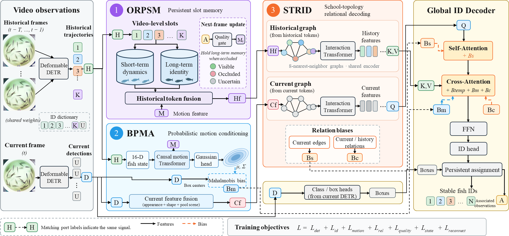

<h1 align="center">SPRINTracker</h1>
<p align="center"><b>Multi-fish tracking with persistent identity memory, probabilistic motion, and school topology</b></p>
<p align="center"><a href="#overview">Overview</a> · <a href="#results">Results</a> · <a href="#getting-started">Getting started</a> · <a href="#model-zoo">Model zoo</a> · <a href="#acknowledgements">Acknowledgements</a></p>

SPRINTracker extends **MOTIP** for tracking visually similar fish in crowded, overhead video. It combines appearance features with motion uncertainty, persistent identity slots, and local relationships within the school. The output consists of bounding boxes and identities that can support downstream trajectory analysis.

## Updates

- Initial source package includes the unified model, training configurations, evaluation entry points, and the architecture figure.
- Dataset videos and model checkpoints are not included. See the prerequisites below before running training or evaluation.

## Overview



**Figure. Overview of SPRINTracker.** Deformable DETR extracts current detections and historical features. ORPSM maintains short-term dynamics and long-term identity representations within persistent slots. BPMA predicts motion distributions and introduces a Mahalanobis-distance bias into identity association. STRID encodes local school relationships and supplies relational features and attention biases. A global ID decoder associates current detections with historical identities, after which matched observations update memory for subsequent frames. Dashed arrows indicate attention biases; solid arrows indicate feature flow.

### Three complementary modules

| Module | Purpose | Implementation |
|---|---|---|
| **ORPSM** — Occlusion-robust persistent slot memory | Preserve identity information through unreliable or missing observations | [persistent_memory.py](models/motip/persistent_memory.py), [runtime_tracker.py](models/runtime_tracker.py) |
| **BPMA** — Boundary-aware probabilistic motion association | Condition association on predicted motion uncertainty and tank geometry | [fish_motion.py](models/motip/fish_motion.py) |
| **STRID** — School-topology relational identity decoding | Use local fish interactions to inform identity decoding | [fish_interaction.py](models/motip/fish_interaction.py), [id_decoder.py](models/motip/id_decoder.py) |

The figure provides a conceptual overview. Implementation details and naming correspondences are documented in [Architecture notes](docs/SPRIN_ARCHITECTURE.md).

## Results

The following values are copied from a saved TrackEval summary for the **four-sequence fish validation split**. They describe checkpoint 13 with an ID threshold of 0.02, not an independent test set. No cross-method ranking is inferred from this row.

| Model | HOTA ↑ | IDF1 ↑ | MOTA ↑ | MOTP ↑ | AssA ↑ | DetA ↑ | IDs ↓ | IDFP ↓ | IDFN ↓ | Frag ↓ |
|---|---:|---:|---:|---:|---:|---:|---:|---:|---:|---:|
| SPRINTracker | 77.70 | 97.02 | 94.30 | 80.20 | 80.78 | 75.14 | 10 | 625 | 798 | 87 |

Accuracy values are percentages. `IDs` denotes CLEAR identity switches (`IDSW`), not the number of predicted tracks. See the [raw summary](results/validation_checkpoint13_summary.txt) and [evaluation notes](docs/SPRIN_EVALUATION.md). Validation-based checkpoint or threshold selection must be reported separately from held-out testing.

## Getting started

### 1. Installation

Linux and an NVIDIA CUDA environment are required for the supplied training workflow. The inherited setup targets Python 3.12, PyTorch 2.4.0, torchvision 0.19.0, and CUDA 12.1. A compatible CUDA toolkit and compiler are needed for the custom deformable-attention operator.

```bash
git clone https://github.com/yuxiaoxuan-Aq/SPRINTracker.git
cd SPRINTracker
conda create -n sprintracker python=3.12
conda activate sprintracker
conda install pytorch==2.4.0 torchvision==0.19.0 torchaudio==2.4.0 pytorch-cuda=12.1 -c pytorch -c nvidia
pip install -r requirements.txt
cd models/ops
sh make.sh
python test.py
cd ../..
```

The portable package has undergone static checks; a clean-environment installation and end-to-end reproduction are still required. The original server source and release edits are distinguished in [Release notes](docs/RELEASE_NOTES.md).

### 2. Dataset preparation

Place fish sequences in the MOT-format layout described in [Fish dataset preparation](docs/SPRIN_DATASET.md). `SportsMOT` is the inherited **loader name**, not a claim that the fish footage comes from the SportsMOT benchmark. Set `DATA_ROOT` in the selected configuration and check sequence-specific slot counts.

### 3. Checkpoint prerequisites

The integration workflow starts from trained component checkpoints. Supply a compatible unified bootstrap checkpoint at `checkpoints/fishmotip_unified_bootstrap.pth`, or construct one from the three trained components.

```bash
PYTHONPATH=. python tools/merge_unified_checkpoints.py   --motion /path/to/motion.pth   --persistent /path/to/persistent.pth   --interaction /path/to/interaction.pth   --output ./checkpoints/fishmotip_unified_bootstrap.pth
```

This utility selects compatible parameter groups; it does not average weights. A fish detector checkpoint is also referenced by the inherited configuration at `checkpoints/fish_detector.pth`. These checkpoints are not supplied in this source package, so the default workflow cannot be reproduced from this repository alone.

### 4. Training

```bash
FISH_NUM_PROCESSES=1 bash train_unified.sh smoke
FISH_NUM_PROCESSES=1 bash train_unified.sh all
```

The wrapper runs an 8-epoch integration stage followed by 30 epochs of joint fine-tuning, and resumes existing stage checkpoints. `stage1` and `stage2` can be selected separately. The `fish_unified_19seq_v1_*` configurations preserve the separate 19-sequence experiment settings and are not automatically selected by this wrapper.

### 5. Evaluation

```bash
FISH_EVAL_PROCESSES=1 FISH_ID_THRESHOLDS="0.02"   bash evaluate_unified.sh /absolute/path/to/checkpoint.pth
```

For the reported 19-sequence experiment configuration, use the explicit entry point in [Evaluation notes](docs/SPRIN_EVALUATION.md). Fix all thresholds before final testing. Save the resolved configuration, checkpoint identifier, sequence list, and raw evaluation output for every reported result.

## Model zoo

| Artifact | Availability |
|---|---|
| Unified model source and configurations | Included |
| Trained SPRINTracker weights | Not bundled; no public download published here |
| Component and detector checkpoints | Required for the supplied training recipe; not bundled |
| Fish dataset and annotations | Not bundled |
| Raw validation summary | Included in `results/` |

## Visualization and downstream analysis

The architecture figure is included above. Evaluation generates tracking outputs for downstream trajectory visualization. Behavior quantification requires separate camera calibration, valid-track filtering, sampling definitions, and measurement validation. The source package does not claim that tracking accuracy alone establishes disease diagnosis or early-warning performance.

## Acknowledgements

This work builds on [MOTIP](https://github.com/MCG-NJU/MOTIP), [Deformable DETR](https://github.com/fundamentalvision/Deformable-DETR), and [TrackEval](https://github.com/JonathonLuiten/TrackEval). The README organization was inspired by [ETETMO](https://github.com/3083156185/ETETMO); SPRINTracker does not implement the ETETMO architecture. Upstream copyright notices and licenses are retained.

## Citation and license

SPRINTracker publication metadata have not been supplied for this release, so no paper citation or acceptance claim is included. Please also cite the upstream methods when using their code. See [LICENSE](LICENSE) and [TrackEval/LICENSE](TrackEval/LICENSE). The original upstream README is retained as [README_MOTIP_ORIGINAL.md](README_MOTIP_ORIGINAL.md) for attribution; its news, model-zoo links, and performance claims refer to MOTIP, not SPRINTracker.
